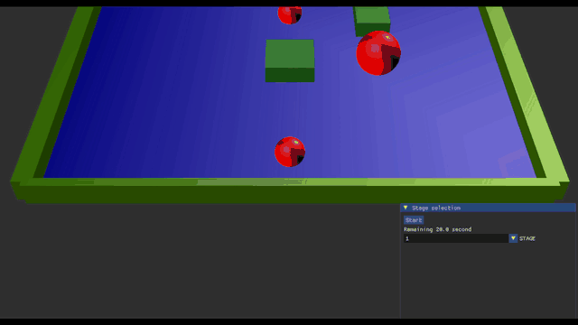
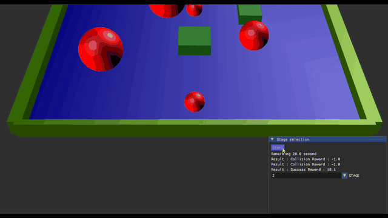
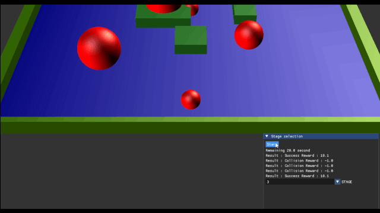
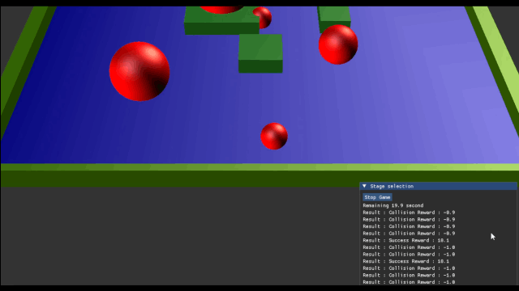
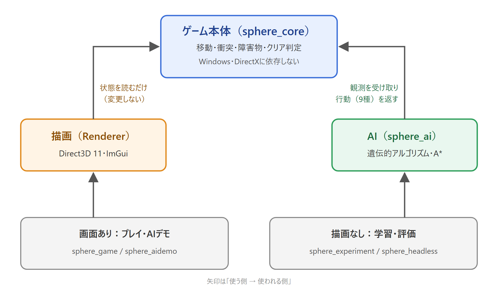
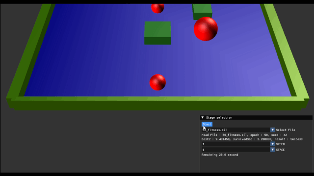
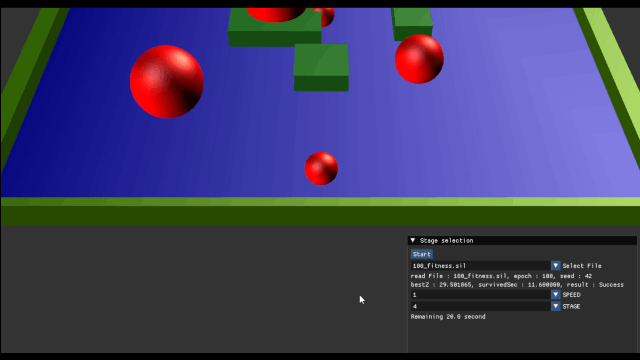
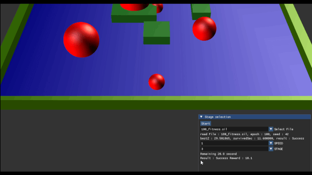
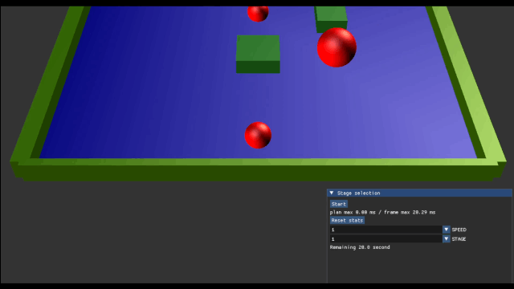

# sphere is learning

- C++20とDirect3D 11で作った見下ろし型の障害物回避ゲーム。動く障害物を避けながら上方のゴールまで進めばクリア
- 現在は全4ステージ
- **AIによるプレイ機能を実装している。**使えるのは遺伝的アルゴリズムとA-star
- こちらの実装についてはMario AI Competition(https://julian.togelius.com/mariocompetition2009/)という、2009年に実施されたゲームAIのコンペを参考にした。
   - このコンペを自分の環境でも動かしてみたかったが、それならゲームも自分で作ってみよう、というのがこのゲームを作ったきっかけ
   - C++および低レイヤーの経験が少なかったので、そういった部分での知識・ノウハウを補いたかったというのもある


<!--  ここの簡単なプレイGIFを入れる  -->

## ゲーム概要

- 赤い球のプレイヤーを操作し、動く障害物を避けながら画面上部のゴールを目指す
    - 操作はWASDを使用。上下左右と斜めの計8方向に移動可能 
- 障害物に当たったらGAME OVERで、即座にリスタートする
- クリアした場合も即座にリスタート。成功/失敗の履歴はUI部分に表示される
- ステージ選択、ゲームの停止・再生もUIから行える。


### 障害物
- 直方体と球体の障害物が存在。3つの軌道いずれかを持っている
   - **Round Trip** : 決まった二点間を移動し続ける
   - **Orbit** : 決まった円軌道を移動し続ける
   - **Chase** : Playerを追いかけてくる speedはオブジェクトごとにまちまち


### 各ステージ

- 各ステージの実際のプレイ映像。

#### stage 1



#### stage 2



#### stage 3



#### stage 4




## 技術面

### 技術スタック

| 分類 | 内容 |
| --- | --- |
| 言語 | C++20 |
| ビルド | CMake 3.24以上（MSVC） |
| 描画 | Direct3D 11、DirectXTK |
| UI | Dear ImGui |

## 設計



- 図はClaudeを用いて作成

設計で守ったルールとして、

1. **ゲームルールの実行と描画の分離**：`src/core`がゲーム自体を実行し、`src/renderer`がDirect3Dによる描画を担う。`src/app`が実行ソースファイル
- これにより、AI訓練時も描画を挟まず高速なシミュレーションを可能に
2. **AIは観測と行動だけで環境とやり取りする**： 人間の入力とAIの行動は同じ形式で行われる(AIは毎フレーム、「どの方向に移動するか」のみを決定する)

## AIの実装

### 遺伝的アルゴリズム

- 参考にした記事：
遺伝的アルゴリズムでやっていく Mario AI Competition 2009
2016-12-19 https://blog.morishin.me/posts/2016/12/19/marioai-2009

#### 観測

- プレイヤーの周囲を3×3のマスに区切り、自分を除く8マスを観測する
- 各マスは「空き・壁・障害物・ゴール」の4種類で、観測は4⁸＝65,536通りの番号で表現される
- 65536の状態それぞれについて「どの行動をするか」を遺伝子(行動表)として保持し、これを更新していく


#### 世代更新

| 処理 | 内容 |
| --- | --- |
| エリートの保存 | 上位32個体をそのまま次世代へ残す |
| 親選択 | ランダムに選んだ3個体のうち適応度が最大の個体を選ぶ操作を2回行い、それらを親とする |
| 交叉 | 両親のうちいずれかの遺伝子をランダムに選択する |
| 突然変異 | 各要素を確率0.02で別の行動に置き換える |

- エージェント数は1エポック512体
- 適応度の計算は
  -  失敗した場合、上方への進行距離
   - 成功した場合、100 - (クリアにかかった時間)
- で算出される。失敗した場合はよりクリアに近づくように、成功した場合はより短時間でクリアできるように学習を進める狙い

#### 結果




- ステージ1で50世代学習した結果。ステージ1はクリアできているが、ステージ2(以降)はクリアできず




- ステージ4で100世代学習した結果。高難易度のステージ4をクリアできている



- ・・・が、それより低難易度のはずのステージ3はクリアできず。単一ステージをクリアすることが目標となっているため、いろんなステージをクリアするAIを得るのは難しかった

### Astarアルゴリズム

- 以下の論文を参考にした： https://www.researchgate.net/publication/224177833_The_2009_Mario_AI_Competition
- 当時のMario AI Competitionではこのアルゴリズムが優勝したらしい

#### 設計

- 経路最適化問題として扱っている
- 実ゲームのシミュレーションをAI側が複製し、各行動を取った場合の状況を実際にシミュレート
- ノードは「ある時刻のゲーム世界(のうち、画面内で表示されているもの)のスナップショット」で、その瞬間に行った行動の結果得られる世界が子ノード
    - 行動としては上下左右斜めの8方向＋「その場に停止」なので、 毎回9つの子ノードが作られる
- 実コストは「スタートしてからの移動回数(経過フレーム)」、ヒューリスティックは「画面内で一番上の部分までの直線距離」
    - 評価関数はこれらの和

- 毎フレームこのアルゴリズムを計算するのはゲーム速度に間に合わないので、前回の経路選定で得た方策に基づいて一定フレーム(今回は50フレーム)だけ移動し、また更新された実環境において次の方策を決定する・・というのを繰り返す
- また、隣接ノード間の違いが1フレームだとほぼ影響がなく、かなり深くまで探索する必要があるので、今回は各ノードで選定した方向に10フレーム移動し、その時点の環境を子ノードにするように設計した

- 一回の方策決定での探索上限は実行時に設定可能

#### 結果



- 一度の探索回数を500回に束縛した場合。最適解までたどり着けないためか、ステージ2はクリアできず


- 一度の探索回数を1500回まで広げた場合。ステージ4まで含めて全ステージをクリアできたが、方策決定時にあきらかにカクついている(グラフィックの描画速度に計算が追いついていない)。

## 工夫した点

### A\*の探索量を抑える

8方向に移動でき、動く障害物を「待つ」必要もあるため、素朴なA\*では展開数が指数的に増える。そこで次の3点で探索量を抑えた。

- **単位を揃えたヒューリスティック**：残り距離を1ステップの移動量で割り、実コスト（ステップ数）と同じ単位に
- **マクロ行動**：1ノードで同じ行動を一定ステップ続け探索の深さを軽減
- **重複状態の枝刈り**：位置を格子に丸めた値と時刻を1つの整数キーにまとめ、`std::unordered_set`で同じ状態の再展開を防ぐ

探索時間はImGuiに表示して計測した。現状は、描画を滑らかに保てる展開数（約500回）と、全ステージのクリアに必要な展開数（約1500回）に差がある。探索を複数フレームに分けて実行するのが今後の課題。

### 障害物を`std::variant`で表現

- 障害物は「形（直方体・球）」と「動き（固定・往復・円軌道・追跡）」の組み合わせで作成した

```cpp
using Shape  = std::variant<Box, Circle>;
using Motion = std::variant<Fixed, RoundTrip, Orbit, Chase>;
```

- 組み合わせごとにクラスを作る必要がない
- ゲームの状態全体を値としてコピーできるのでA-starが環境を複製して先読みする処理にそのまま使える
- といったメリットが有る

## ビルドと実行（Windows）

必要なもの：Visual Studio 2022（C++によるデスクトップ開発）、CMake 3.24以上、Git

```powershell
git clone --recursive https://github.com/JUPIPIYO/sphere_is_learning.git
cd sphere_is_learning
.\scripts\build.ps1 -RunTests
```

| 実行ファイル | 内容 |
| --- | --- |
| `build\Debug\sphere_game.exe` | ゲームを普通に遊ぶ |
| `build\Debug\sphere_aidemo.exe` | 保存したAIのプレイを画面で再生 |
| `build\Debug\sphere_experiment.exe` | 描画なしでGAの学習・評価、A\*の実行 |

### ゲームを遊ぶ

```powershell
.\build\Debug\sphere_game.exe
```

WASDで移動する。ステージの選択と停止・再開は画面上のUIから行う。

### AIのプレイを画面で見る（sphere_aidemo）

```powershell
# GA：第1引数に ga、第2引数に保存フォルダ、第3引数に読み込む個体のファイルを指定する
.\build\Debug\sphere_aidemo.exe ga results\GA\stage4\per512\07cell\seed42 results\GA\stage4\per512\07cell\seed42\100_fitness.sil

# A*：第1引数に astar、第2引数に探索の深さ、第3引数に1回の探索で展開する最大ノード数を指定する
.\build\Debug\sphere_aidemo.exe astar 100 1500
```

- 引数はすべて省略できない
- ステージ（1〜4）、再生速度（1・2・4倍）、表示する個体（保存フォルダ内のファイル）は画面上のUIで切り替えられる

### 学習・評価（sphere_experiment）

```powershell
# GAの学習：ステージ4で100世代学習し、結果を指定したフォルダに保存する
.\build\Debug\sphere_experiment.exe train --stage 4 --seed 42 --generations 100 --output results\GA\stage4\seed42

# 保存した個体の評価
.\build\Debug\sphere_experiment.exe evaluate --stage 4 --seed 42 --input results\GA\stage4\seed42\100_fitness.sil --evaluations 10

# A*で1回プレイして結果を表示
.\build\Debug\sphere_experiment.exe astar --stage 4 --seed 42 --expandDepth 100 --maxExpand 1500
```

| オプション | 内容 | 既定値 |
| --- | --- | --- |
| `--stage 1〜4` | ステージ番号（**必ず指定する**） | なし |
| `--seed` | 環境の乱数シード | 42 |
| `--generations` | 学習する世代数（train） | 20 |
| `--output` | 保存先フォルダ（train） | agent |
| `--input` | 読み込む個体のファイル（evaluate、必須） | なし |
| `--evaluations` | 試行回数（evaluate） | 1 |
| `--expandDepth` / `--maxExpand` | 探索の深さ / 最大展開数（astar） | 100 / 1000 |

学習中は世代ごとの最良の適応度、最高到達点、生存時間、終了状態を出力する。保存されるのは、第0世代、中間の世代、最終世代、50世代ごとの最良個体で、適応度が最大の個体（`_fitness.sil`）と到達距離が最大の個体（`_distance.sil`）の2種類がある。

macOS / Linuxでは、シミュレーションとテストだけビルド可能

```sh
cmake -S . -B build
cmake --build build
ctest --test-dir build --output-on-failure
```

## ディレクトリ構成

```text
src/
  core/                 シミュレーション（描画非依存）
  renderer/directX11/   Direct3D 11による描画
  ai/common/            観測・1試行の実行などの部品
  ai/ga/                遺伝的アルゴリズム・個体の保存
  ai/Astar/             A*による経路探索（追加実験）
  app/                  ゲーム・AIデモ・学習CLIのエントリーポイント
external/               DirectXTK、Dear ImGui（gitサブモジュール）
docs/                   仕様・設計・作業記録
```

## 制作情報

- 制作人数：1人
- 制作期間：1ヶ月程度
- コード規模：C++ 約2,600行（`src/`。空行・コメント行を除くと約2,000行。`external/`の外部ライブラリは除く）

| 範囲 | 行数 | 空行・コメント行を除く |
| --- | ---: | ---: |
| `src/core`（ゲーム本体） | 527 | 400 |
| `src/renderer`（描画） | 278 | 201 |
| `src/ai/common` | 176 | 130 |
| `src/ai/ga` | 300 | 230 |
| `src/ai/Astar` | 247 | 173 |
| `src/app`（ゲーム・AIデモ・学習CLI） | 1,112 | 875 |
| **合計** | **2,640** | **2,009** |
- AIツールの利用：DirectX、ImGuiなどの初学およびコードレビューに用いた。Claude Codeに学習教材を作成してもらい、それを下に学習・実装を進めた。

## ライセンス・素材

[MIT License](LICENSE)

ゲームの素材・ステージ配置・名称はすべてオリジナル。外部ライブラリはそれぞれのライセンスに従う（DirectXTK: MIT、Dear ImGui: MIT）。
